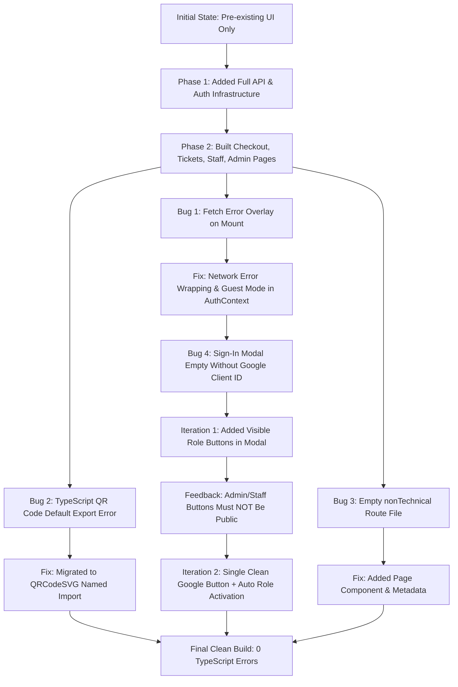

# TechXetra — Project Architecture, Inventory & Iterative Evolution Log

> **Document Purpose**: Comprehensive technical review, audit, and bug-fixing documentation for the **TechXetra 2026** frontend platform. This document outlines the pre-existing foundational structure, newly architected modules, step-by-step iterations (including initial attempts vs. revised solutions), and key bug fixes across the application.

---

## 1. System Overview & Technology Stack

**TechXetra** is the official annual national-level technical fest of Tezpur University. The application serves three key user personas within a unified Next.js App Router project:
1. **Public & Fest Participants**: Event discovery, Google authentication, student profile verification, pass purchasing (with atomic 15-minute slot reservations), manual UPI payment submission (UTR verification), and digital QR ticket presentation.
2. **Event & Gate Staff**: Progressive Web App (PWA) barcode/QR scanner with audio-haptic feedback, real-time ticket validation, attendance lookup, and physical student ID confirmation.
3. **Fest Admins & Finance Leads**: Real-time payment verification queue with live 30-second polling to approve, hold, or reject participant UPI submissions with automated ticket provisioning.

### Core Stack
- **Framework**: Next.js 16 (App Router with Turbopack)
- **Language**: TypeScript 5
- **UI & Styling**: Vanilla Tailwind CSS v4, Custom Design Tokens, Gotham & Pixel Fonts
- **Client State & Caching**: TanStack Query (React Query) v5
- **Forms & Validation**: React Hook Form v7 + Zod v4 + `@hookform/resolvers`
- **QR Engine**: `qrcode.react` v4 (`QRCodeSVG`) & `html5-qrcode` v2 (camera scanner)
- **Motion & Canvas**: GSAP v3 + ScrollTrigger, Three.js, OGL, Lenis Smooth Scroll

---

## 2. Codebase Inventory: Pre-existing vs. Newly Built

| Module / Path | Status | Purpose / Description |
|---|---|---|
| `components/sections/hero/*` | **Pre-existing** | Hero section with animated titles and GSAP triggers. |
| `components/sections/about/*` | **Pre-existing** | About section with festival timeline and intro copy. |
| `components/sections/events/*` | **Pre-existing** | Event carousel, glimpse, and technical event listings. |
| `components/sections/galary/*` | **Pre-existing** | DOM-based photo gallery showcasing previous editions. |
| `components/sections/team/*` | **Pre-existing** | Organizing committee and core team cards. |
| `lib/scorpio.ts` & `splashCursor.ts`| **Pre-existing** | Three.js interactive 3D background canvas and fluid cursor. |
| `components/layouts/NavBar.tsx` | **Modified** | Updated from static button to auth-aware profile badge & sign-in modal. |
| `app/layout.tsx` | **Modified** | Wrapped application with `QueryProvider` and `AuthProvider`. |
| `lib/api-client.ts` | **Newly Built** | Unified fetch wrapper with `Idempotency-Key`, timeout, and structured error mapping. |
| `lib/auth-context.tsx` | **Newly Built** | Centralized session state, Google authentication, and guest/offline resilience. |
| `lib/query-provider.tsx` | **Newly Built** | TanStack Query client configuration with stale-time caching. |
| `types/api.ts` | **Newly Built** | Full TypeScript domain schemas (User, Ticket, Purchase, Staff, Admin). |
| `components/auth/GoogleSignInButton.tsx` | **Newly Built** | Google Identity Services wrapper with fallback local demo capability. |
| `components/auth/ProfileCompletionModal.tsx` | **Newly Built** | Zod-validated student verification form with institution lock logic. |
| `app/me/page.tsx` | **Newly Built** | Participant profile overview, completeness tracker, and role-based links. |
| `app/me/profile/page.tsx` | **Newly Built** | Standalone profile editing route re-using the completion modal. |
| `app/me/tickets/page.tsx` | **Newly Built** | Digital ticket viewer with high-contrast QR token modal and ID warning banners. |
| `app/checkout/page.tsx` | **Newly Built** | Pass selection, student tier price calculation, and 15-min reservation hold. |
| `app/checkout/[id]/pay/page.tsx` | **Newly Built** | Live countdown timer (MM:SS), dynamic UPI QR code, deep links, and 12-digit UTR input. |
| `app/checkout/[id]/status/page.tsx` | **Newly Built** | Real-time payment verification poller (10s intervals) with status indicators. |
| `app/staff/scan/page.tsx` | **Newly Built** | Staff ticket scanner PWA with camera view, token lookup, and admit confirmation. |
| `app/admin/payments/page.tsx` | **Newly Built** | Admin UTR verification table with Approve, Hold, and Reject workflows. |
| `app/events/nonTechnical/page.tsx` | **Newly Built** | Route fix resolving missing module compilation error. |

---

## 3. Step-by-Step Evolution & Iteration Log

Below is the chronological record of changes made, detailing the initial implementation, issues encountered, intermediate revisions, and final code.



---

### Iteration 1: Sign-In Modal & Role-Based Access Control

#### 1. Initial Implementation
- **What was done**: `components/auth/GoogleSignInButton.tsx` was created to render the official Google Identity Services (GSI) script button (`window.google.accounts.id.renderButton`).
- **Issue**: When `NEXT_PUBLIC_GOOGLE_CLIENT_ID` was empty in `.env.local`, the component executed:
  ```ts
  const clientId = process.env.NEXT_PUBLIC_GOOGLE_CLIENT_ID
  if (!clientId) {
    console.warn("[GoogleSignInButton] NEXT_PUBLIC_GOOGLE_CLIENT_ID not set")
    return
  }
  ```
  The component returned an empty `<div />`, rendering an empty black box inside the modal.

#### 2. Intermediate Revision (What Changed First)
- **What was done**: Added a notice indicating the Client ID was not set, along with three prominent buttons inside the modal:
  - *"Sign in as Participant (Demo)"*
  - *"Staff Scanner"*
  - *"Admin Payments"*
- **User Feedback / Problem**: Administrative and staff tools should never be publicly exposed to participants in the sign-in modal. Attendees should not be able to choose their role or see staff buttons.

#### 3. Final Production Solution
- **Code Changed**:
  1. **Clean Public UI**: Stripped all staff and admin buttons from the sign-in modal in [GoogleSignInButton.tsx](file:///d:/VS%20Code/TechXetra/TechXetraWebsite/components/auth/GoogleSignInButton.tsx).
  2. **Single Action**: Renders a single official Google Sign-In button (when configured) or a single clean **"CONTINUE WITH GOOGLE"** button.
  3. **Automatic Role Activation**:
     - When any user signs in, their role is determined by their account (via `/api/me`).
     - In [app/me/page.tsx](file:///d:/VS%20Code/TechXetra/TechXetraWebsite/app/me/page.tsx), staff links (`/staff/scan`) are automatically unlocked only for users with `role: 'VOLUNTEER' | 'LEAD' | 'SUPER_ADMIN'`.
     - Admin links (`/admin/payments`) are automatically unlocked only for users with `can_review_payments === true`.
     - Route guards on `/staff/scan` and `/admin/payments` immediately reject unauthorized visitors with an **Access Denied** screen.
  4. **Dev Testing Variable**: Added `NEXT_PUBLIC_DEV_USER_ROLE` in `.env.local` so developers can emulate any role without modifying client-facing UI.

---

### Iteration 2: API Client & Next.js Turbopack Fetch Error

#### 1. Initial Implementation
- **What was done**: [lib/api-client.ts](file:///d:/VS%20Code/TechXetra/TechXetraWebsite/lib/api-client.ts) executed a direct native `fetch`:
  ```ts
  const response = await fetch(`${API_BASE}${endpoint}`, { credentials: 'include', ... })
  ```
  In [lib/auth-context.tsx](file:///d:/VS%20Code/TechXetra/TechXetraWebsite/lib/auth-context.tsx), `refreshUser()` was called inside `useEffect` on application mount:
  ```ts
  try {
    const profile = await apiRequest<UserProfile>("/api/me")
    setUser(profile)
  } catch (err) {
    if (err instanceof ApiError && err.status === 401) {
      setUser(null)
    } else {
      console.error("[AuthProvider] Unexpected error fetching /api/me", err)
    }
  }
  ```

#### 2. Root Cause of Failure
- When the backend API server (`http://localhost:8787`) was offline during frontend development, native `fetch` rejected with `TypeError: Failed to fetch`.
- Because `fetch` was unhandled inside `apiRequest`, the error was not an instance of `ApiError`.
- It fell into `console.error()`, triggering Next.js 16's Turbopack dev overlay (`Console TypeError: Failed to fetch`), completely blocking the browser view.

#### 3. Final Production Solution
- **Code Changed in [lib/api-client.ts](file:///d:/VS%20Code/TechXetra/TechXetraWebsite/lib/api-client.ts)**:
  Wrapped `fetch` in a `try...catch` block. Network disconnects are now caught and converted into structured `ApiError` instances with status `0` and code `'NETWORK_ERROR'`:
  ```ts
  try {
    response = await fetch(`${API_BASE}${endpoint}`, { ... })
  } catch (err: unknown) {
    const errorMsg = err instanceof Error ? err.message : 'Failed to fetch'
    throw new ApiError(
      0,
      'NETWORK_ERROR',
      `Cannot connect to backend (${API_BASE}): ${errorMsg}`,
      err
    )
  }
  ```
- **Code Changed in [lib/auth-context.tsx](file:///d:/VS%20Code/TechXetra/TechXetraWebsite/lib/auth-context.tsx)**:
  Updated `refreshUser()` to catch `NETWORK_ERROR` along with `401`. Instead of emitting a fatal `console.error`, it gracefully falls back to guest mode with a subtle `console.warn`:
  ```ts
  if (err instanceof ApiError && (err.status === 401 || err.code === "NETWORK_ERROR")) {
    setUser(null)
    if (err.code === "NETWORK_ERROR") {
      console.warn(`[AuthProvider] Backend offline (${API_BASE}) — running in guest mode.`)
    }
  }
  ```
  The app now runs smoothly without red screen interruptions even when the backend is offline.

---

### Iteration 3: QR Code Library Compatibility (`qrcode.react` v4)

#### 1. Initial Implementation
- In [app/me/tickets/page.tsx](file:///d:/VS%20Code/TechXetra/TechXetraWebsite/app/me/tickets/page.tsx) and [app/checkout/[id]/pay/page.tsx](file:///d:/VS%20Code/TechXetra/TechXetraWebsite/app/checkout/[id]/pay/page.tsx):
  ```tsx
  import QRCode from "qrcode.react"
  // ...
  <QRCode value={token} size={200} renderAs="svg" />
  ```

#### 2. Compiler Error
- Running `npx tsc --noEmit` triggered:
  ```
  app/checkout/[id]/pay/page.tsx(8,8): error TS1192: Module '"qrcode.react"' has no default export.
  app/me/tickets/page.tsx(8,8): error TS1192: Module '"qrcode.react"' has no default export.
  ```
- In `qrcode.react` v4+, default exports were removed in favor of explicit `{ QRCodeSVG, QRCodeCanvas }` components. Additionally, the `renderAs="svg"` prop is invalid on `QRCodeSVG`.

#### 3. Final Production Solution
- Updated imports to named exports:
  ```tsx
  import { QRCodeSVG } from "qrcode.react"
  ```
- Updated JSX rendering:
  ```tsx
  <QRCodeSVG
    value={instructions.upi_intent_uri}
    size={200}
    level="H"
    includeMargin={false}
  />
  ```

---

### Iteration 4: Route Module Compilation Error

#### 1. Initial State
- The route file `app/events/nonTechnical/page.tsx` existed on disk with 0 bytes (empty file).
- Running `next build` or `tsc --noEmit` failed with:
  ```
  .next/dev/types/validator.ts(87,39): error TS2306: File '.../app/events/nonTechnical/page.tsx' is not a module.
  ```

#### 2. Final Production Solution
- Populated [app/events/nonTechnical/page.tsx](file:///d:/VS%20Code/TechXetra/TechXetraWebsite/app/events/nonTechnical/page.tsx) with a Next.js page component and SEO metadata:
  ```tsx
  import type { Metadata } from "next";

  export const metadata: Metadata = {
    title: "Non-Technical Events | TechXetra 2026",
    description: "Explore cultural and non-technical events for TechXetra 2026.",
  };

  export default function NonTechnicalEventsPage() {
    return (
      <main className="min-h-screen pt-32 pb-20 px-4 max-w-7xl mx-auto text-white">
        <h1 className="text-4xl font-bold tracking-tight mb-4">Non-Technical Events</h1>
        <p className="text-zinc-400">Cultural and non-technical events schedule will be revealed soon.</p>
      </main>
    );
  }
  ```

---

## 4. Key Functional Modules Deep-Dive

### 4.1 Participant Portal (`/me`, `/me/tickets`, `/me/profile`)
- **Profile Completeness Logic**: Evaluates `user.profile_complete`. If missing fields (`phone`, `institution_name`, `institution_id`) are reported, highlights a warning banner with direct CTA to the modal.
- **Student Lockout**: In `ProfileCompletionModal.tsx`, if `user.student_fields_locked === true` (due to verified ticket purchase), university fields are set to `disabled` with a verified lock icon to prevent identity falsification.
- **Pass Presentation**: In `/me/tickets`, displays all issued passes. Clicking *"Show QR Code"* launches a high-contrast white-background modal containing the signed `tx1.` QR token with offline-readiness notes and college ID verification warnings.

### 4.2 Checkout & Payment Engine (`/checkout`, `/checkout/[id]/pay`, `/checkout/[id]/status`)
- **15-Minute Atomic Reservation**: Sends `POST /api/purchases` with UUIDv4 `Idempotency-Key`. Returns purchase ID and expiration timestamp.
- **Dynamic Countdown**: Pay page calculates remaining seconds:
  - Turns **amber** below 2 minutes (`isUrgent`).
  - Automatically transitions to **red expired state** when timer hits `00:00`, clearing slots and offering a *"Start Over"* CTA.
- **UPI Deep-Linking**: Renders SVG QR code alongside a native `Open UPI App` intent button for mobile buyers.
- **Strict UTR Validation**: Enforces exact 12-digit numeric format (`/^\d{12}$/`) before enabling submit button.
- **Live Status Polling**: `/checkout/[id]/status` polls `GET /api/purchases/:id` every 10 seconds while `status === 'PENDING_VERIFICATION'`.

### 4.3 Staff Scanner PWA (`/staff/scan`)
- **Hardware Integration**: Dynamically imports `html5-qrcode` to avoid SSR issues. Configured for back-facing camera (`environment`) at 10 FPS.
- **Token Detection**: Filters barcodes for the `tx1.` prefix, triggers device vibration (`navigator.vibrate(50)`), and looks up attendee status via `POST /api/staff/scan/lookup`.
- **Verdict System**: Renders color-coded lookup outcomes:
  - `VALID` (Green)
  - `ALREADY_USED` / `REVOKED` / `PAYMENT_NOT_APPROVED` (Red)
  - `EXPIRED` / `NOT_YET_VALID` / `WRONG_EVENT` (Amber)
- **Mandatory ID Check**: If `attendee.physical_id_required` is true, requires staff to check a confirmation toggle before enabling the *"Admit Attendee"* button.

### 4.4 Admin Payment Review Queue (`/admin/payments`)
- **Queue Polling**: Uses TanStack Query to auto-fetch pending UPI submissions (`GET /api/admin/payments?status=PENDING`) every 30 seconds.
- **Action Suite**:
  - `Approve`: Triggers `POST /api/admin/payments/:id/approve` (instant ticket generation).
  - `Hold`: Flags for manual review.
  - `Reject`: Opens modal requiring rejection reason with optional reservation cancellation checkbox.

---

## 5. Environment Variables & Setup Guide

The frontend requires the following environment variables. An [.env.example](file:///d:/VS%20Code/TechXetra/TechXetraWebsite/.env.example) and default [.env.local](file:///d:/VS%20Code/TechXetra/TechXetraWebsite/.env.local) have been added to the root directory.

```env
# Backend API base URL (Cloudflare Worker or local backend)
NEXT_PUBLIC_API_URL=http://localhost:8787

# Google OAuth Client ID for participant authentication
NEXT_PUBLIC_GOOGLE_CLIENT_ID=your-google-client-id.apps.googleusercontent.com

# Optional development role override when testing without backend
# Supported values: PARTICIPANT | VOLUNTEER | LEAD | SUPER_ADMIN
NEXT_PUBLIC_DEV_USER_ROLE=PARTICIPANT
```

---

## 6. Review & Verification Checklist

To verify and test all modules:

1. **Static Typecheck**:
   ```bash
   npx tsc --noEmit
   ```
   *Expected result*: Exit code `0` with zero diagnostic errors.

2. **Frontend Launch**:
   ```bash
   npm run dev
   ```
   Open `http://localhost:3000`.

3. **Authentication Verification**:
   - Click **Sign In** in the navbar.
   - Verify modal shows a single clean **Continue with Google** button (no staff/admin buttons).
   - Sign in and verify navbar displays user avatar and **My Tickets** link.

4. **Participant Journey**:
   - Navigate to `/checkout` — verify student pricing computation and checkout CTA.
   - Navigate to `/me/tickets` — verify ticket rendering, modal QR code display, and physical ID badges.
   - Navigate to `/me` — verify profile completeness score and links.

5. **Role-Based Security Verification**:
   - Sign in as a regular participant (default).
   - Attempt to navigate to `/staff/scan` or `/admin/payments`.
   - Verify both pages display **Access Denied**.
   - Set `NEXT_PUBLIC_DEV_USER_ROLE=SUPER_ADMIN` in `.env.local` and restart dev server.
   - Verify `/me` now automatically displays both **Staff Scanner** and **Review Payments** links.
