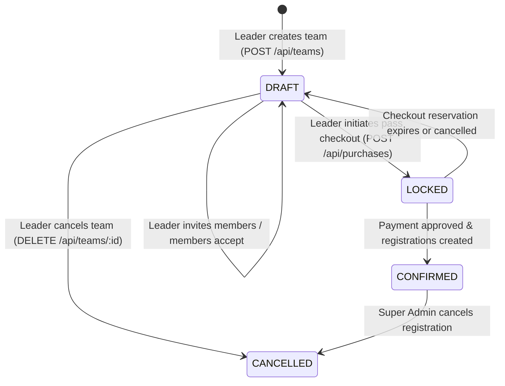

# Module 03: Teams and Invitations

This document covers team formation, roster management, email invitations, invitation responses, and participant team dashboards.

---

## 1. Overview & Team Lifecycle



### 1.1 Team State Machine
- **`DRAFT`**: The team is forming. The leader can invite members, remove members, or disband the team. Members can accept or decline invitations, or leave the team.
- **`LOCKED`**: A purchase reservation has been initiated by the team leader. Roster edits are prohibited while payment is pending.
- **`CONFIRMED`**: Payment has been verified. Tickets and registration records have been officially issued. Members cannot be removed by the leader.
- **`CANCELLED`**: The team was disbanded or its registration cancelled.

### 1.2 Team Eligibility Rules for Checkout
Before a team can proceed to checkout (`POST /api/purchases`), the following criteria must be met:
1. All invitations must be resolved: there must be **0 pending invitations** (`status === 'INVITED'`). Every invited person must have either accepted or been removed.
2. The number of accepted members must satisfy:
   $$\text{min\_team\_size} \le \text{accepted members} \le \text{max\_team\_size}$$
3. **Every single member** in the team roster must have completed their profile (`profile_complete === true`). If even one member hasn't, checkout will fail with `403 PROFILE_INCOMPLETE`.

---

## 2. Team Management Endpoints

### 2.1 Create Team
Creates a new team for a team-based event. The caller automatically becomes the `LEADER` with an `ACCEPTED` member status.

- **Method**: `POST`
- **Path**: `/api/teams`
- **Authentication**: Session Required + Profile Complete Required
- **Request Headers**:
  - `Content-Type: application/json`
  - `Cookie: __Host-session=<token>`
  - `Origin: <FRONTEND_ORIGIN>`

#### Request Body Schema
| Field | Type | Required | Validation Rules |
|---|---|---|---|
| `event_id` | `string` | **Yes** | Valid event UUID |
| `name` | `string` | **Yes** | Team name: 2 to 50 characters |

```json
{
  "event_id": "evt_01j8k92b4m10ac",
  "name": "CyberKnights"
}
```

#### Success Response
- **Status**: `201 Created`
```json
{
  "success": true,
  "data": {
    "id": "tm_01j8m49p1k90ab",
    "event_id": "evt_01j8k92b4m10ac",
    "name": "CyberKnights",
    "leader_id": "usr_01j8k92b4m10ac",
    "status": "DRAFT",
    "created_at": 1729432800000,
    "updated_at": 1729432800000,
    "members": [
      {
        "id": "tmm_01j8m49p2a10cd",
        "team_id": "tm_01j8m49p1k90ab",
        "user_id": "usr_01j8k92b4m10ac",
        "invited_email": "leader@tezu.ac.in",
        "role": "LEADER",
        "status": "ACCEPTED",
        "invited_at": 1729432800000,
        "responded_at": 1729432800000,
        "user": {
          "id": "usr_01j8k92b4m10ac",
          "name": "Priyanku Sharma",
          "email": "leader@tezu.ac.in",
          "avatar_url": null,
          "is_student": true,
          "institution_name": "Tezpur University",
          "institution_id": "CSB22001",
          "profile_completed_at": 1729432000000
        }
      }
    ]
  },
  "request_id": "req_01j7xyz..."
}
```

#### Possible Errors
| HTTP Status | Error Code | Description / Reason |
|---|---|---|
| `400` | `BAD_REQUEST` | Event is solo (not a team event), event is not open, or registration deadline has passed. |
| `401` | `UNAUTHORIZED` | Session missing or expired. |
| `403` | `PROFILE_INCOMPLETE` | Caller has not completed their profile. |
| `404` | `NOT_FOUND` | Event does not exist. |
| `409` | `ALREADY_LEADER` | Caller is already leading another active team for this event. |
| `409` | `TEAM_NAME_TAKEN` | A team with this name already exists for this event. |
| `409` | `MEMBER_ALREADY_IN_TEAM`| Caller is already an accepted member in another team for this event. |

---

### 2.2 Get Team Details & Roster
Fetches team info and all roster members.
- **Privacy & Existence Hiding**: For security and attendee privacy, this endpoint returns `404 NOT_FOUND` to any caller who is not an active/invited member of the team, an assigned event staff member, or a Super Admin.

- **Method**: `GET`
- **Path**: `/api/teams/:id`
- **Authentication**: Session Required
- **Path Parameters**:
  - `id`: Team UUID.

#### Success Response
- **Status**: `200 OK`
```json
{
  "success": true,
  "data": {
    "id": "tm_01j8m49p1k90ab",
    "event_id": "evt_01j8k92b4m10ac",
    "name": "CyberKnights",
    "leader_id": "usr_01j8k92b4m10ac",
    "status": "DRAFT",
    "created_at": 1729432800000,
    "updated_at": 1729432800000,
    "members": [
      {
        "id": "tmm_01j8m49p2a10cd",
        "team_id": "tm_01j8m49p1k90ab",
        "user_id": "usr_01j8k92b4m10ac",
        "invited_email": "leader@tezu.ac.in",
        "role": "LEADER",
        "status": "ACCEPTED",
        "invited_at": 1729432800000,
        "responded_at": 1729432800000,
        "user": {
          "id": "usr_01j8k92b4m10ac",
          "name": "Priyanku Sharma",
          "email": "leader@tezu.ac.in",
          "avatar_url": null,
          "is_student": true,
          "institution_name": "Tezpur University",
          "institution_id": "CSB22001",
          "profile_completed_at": 1729432000000
        }
      },
      {
        "id": "tmm_01j8m50q7b20ef",
        "team_id": "tm_01j8m49p1k90ab",
        "user_id": "usr_01j8k93c5n20bd",
        "invited_email": "teammate@tezu.ac.in",
        "role": "MEMBER",
        "status": "INVITED",
        "invited_at": 1729433000000,
        "responded_at": null,
        "user": {
          "id": "usr_01j8k93c5n20bd",
          "name": "Rohit Das",
          "email": "teammate@tezu.ac.in",
          "avatar_url": null,
          "is_student": true,
          "institution_name": "Tezpur University",
          "institution_id": "CSB22045",
          "profile_completed_at": 1729432500000
        }
      }
    ]
  },
  "request_id": "req_01j7xyz..."
}
```

#### Possible Errors
| HTTP Status | Error Code | Description / Reason |
|---|---|---|
| `401` | `UNAUTHORIZED` | Session missing or expired. |
| `404` | `NOT_FOUND` | Team does not exist or caller is not authorized to view this team. |

---

### 2.3 Disband / Cancel Team
Disbands a team. Marks team `CANCELLED` and marks all active and invited members `REMOVED`.

- **Method**: `DELETE`
- **Path**: `/api/teams/:id`
- **Authentication**: Session Required (must be Team Leader or Super Admin)
- **Path Parameters**:
  - `id`: Team UUID.

#### Success Response
- **Status**: `200 OK`
```json
{
  "success": true,
  "data": {
    "cancelled": true
  },
  "request_id": "req_01j7xyz..."
}
```

#### Possible Errors
| HTTP Status | Error Code | Description / Reason |
|---|---|---|
| `403` | `FORBIDDEN` | Caller is not the team leader. |
| `404` | `NOT_FOUND` | Team does not exist. |
| `409` | `CONFLICT` | Team is not in `DRAFT` status (e.g. `LOCKED` or `CONFIRMED`). |

---

## 3. Team Member Invitations

### 3.1 Invite Teammate by Email
Allows the team leader to invite a participant to join their team.
- If the invitee already has an account, their `user_id` is automatically linked.
- If not yet registered, an invitation record is preserved for when they sign up with that email.

- **Method**: `POST`
- **Path**: `/api/teams/:id/invites`
- **Authentication**: Session Required + Profile Complete Required (Caller must be Team Leader)
- **Request Headers**:
  - `Content-Type: application/json`
  - `Cookie: __Host-session=<token>`
  - `Origin: <FRONTEND_ORIGIN>`

#### Request Body Schema
| Field | Type | Required | Description |
|---|---|---|---|
| `email` | `string` | **Yes** | Valid email address of invitee |

```json
{
  "email": "teammate@tezu.ac.in"
}
```

#### Success Response
- **Status**: `201 Created`
```json
{
  "success": true,
  "data": {
    "id": "tmm_01j8m50q7b20ef",
    "team_id": "tm_01j8m49p1k90ab",
    "user_id": "usr_01j8k93c5n20bd",
    "invited_email": "teammate@tezu.ac.in",
    "role": "MEMBER",
    "status": "INVITED",
    "invited_at": 1729433000000,
    "responded_at": null
  },
  "request_id": "req_01j7xyz..."
}
```

#### Possible Errors
| HTTP Status | Error Code | Description / Reason |
|---|---|---|
| `400` | `BAD_REQUEST` | Cannot invite yourself, or event registration deadline has passed. |
| `400` | `VALIDATION_ERROR` | Email address is invalid. |
| `403` | `FORBIDDEN` | Caller is not the team leader. |
| `404` | `NOT_FOUND` | Team does not exist. |
| `409` | `CONFLICT` | Team is not in `DRAFT` status, team has reached `max_team_size`, or invitee already has an active team for this event. |
| `409` | `MEMBER_ALREADY_INVITED`| User is already invited or a member of this team. |

---

### 3.2 Remove Member or Cancel Invitation
Allows the team leader to remove a member or revoke an invite. Also allows a member to leave the team.
- **Leader Protection**: The team leader cannot be removed. To abandon the team, the leader must disband the team (`DELETE /api/teams/:id`).

- **Method**: `DELETE`
- **Path**: `/api/teams/:id/members/:memberId`
- **Authentication**: Session Required (must be Team Leader or the member themselves)
- **Path Parameters**:
  - `id`: Team UUID.
  - `memberId`: Team member row UUID (`tmm_...`).

#### Success Response
- **Status**: `200 OK`
```json
{
  "success": true,
  "data": {
    "removed": true
  },
  "request_id": "req_01j7xyz..."
}
```

#### Possible Errors
| HTTP Status | Error Code | Description / Reason |
|---|---|---|
| `400` | `BAD_REQUEST` | Attempted to remove the team leader. |
| `403` | `FORBIDDEN` | Caller is neither the leader nor the member themselves. |
| `404` | `NOT_FOUND` | Member or team not found. |
| `409` | `CONFLICT` | Team is not in `DRAFT` status. |

---

## 4. Responding to Invitations

### 4.1 Accept Team Invitation
Accepts a pending team invitation.
- Atomically verifies that the team has not filled up in the meantime and that the user hasn't joined another team for this event.

- **Method**: `POST`
- **Path**: `/api/team-invites/:memberId/accept`
- **Authentication**: Session Required + Profile Complete Required
- **Path Parameters**:
  - `memberId`: Team member invitation UUID (`tmm_...`).

#### Success Response
- **Status**: `200 OK`
```json
{
  "success": true,
  "data": {
    "id": "tmm_01j8m50q7b20ef",
    "team_id": "tm_01j8m49p1k90ab",
    "user_id": "usr_01j8k93c5n20bd",
    "invited_email": "teammate@tezu.ac.in",
    "role": "MEMBER",
    "status": "ACCEPTED",
    "invited_at": 1729433000000,
    "responded_at": 1729433500000
  },
  "request_id": "req_01j7xyz..."
}
```

#### Possible Errors
| HTTP Status | Error Code | Description / Reason |
|---|---|---|
| `401` | `UNAUTHORIZED` | Session missing or expired. |
| `403` | `PROFILE_INCOMPLETE` | Caller must complete profile before accepting invites. |
| `404` | `NOT_FOUND` | Invitation does not exist, or was addressed to another user. |
| `409` | `CONFLICT` | Invitation is not in `INVITED` status, team is no longer in `DRAFT`, team is full, or user is already in another active team for this event. |

---

### 4.2 Decline Team Invitation
Declines a pending team invitation.

- **Method**: `POST`
- **Path**: `/api/team-invites/:memberId/decline`
- **Authentication**: Session Required
- **Path Parameters**:
  - `memberId`: Team member invitation UUID (`tmm_...`).

#### Success Response
- **Status**: `200 OK`
```json
{
  "success": true,
  "data": {
    "id": "tmm_01j8m50q7b20ef",
    "team_id": "tm_01j8m49p1k90ab",
    "user_id": "usr_01j8k93c5n20bd",
    "invited_email": "teammate@tezu.ac.in",
    "role": "MEMBER",
    "status": "DECLINED",
    "invited_at": 1729433000000,
    "responded_at": 1729433600000
  },
  "request_id": "req_01j7xyz..."
}
```

---

## 5. User Team Views (`/api/me`)

### 5.1 Get My Teams
Fetches all active teams where the current user is a leader or accepted/invited member.

- **Method**: `GET`
- **Path**: `/api/me/teams`
- **Authentication**: Session Required

#### Success Response
- **Status**: `200 OK`
```json
{
  "success": true,
  "data": [
    {
      "id": "tm_01j8m49p1k90ab",
      "event_id": "evt_01j8k92b4m10ac",
      "name": "CyberKnights",
      "leader_id": "usr_01j8k92b4m10ac",
      "status": "DRAFT",
      "created_at": 1729432800000,
      "updated_at": 1729432800000,
      "members": [ ... ]
    }
  ],
  "request_id": "req_01j7xyz..."
}
```

---

### 5.2 Get My Pending Team Invitations
Fetches all incoming invitations currently waiting for the user's accept/decline action.

- **Method**: `GET`
- **Path**: `/api/me/team-invites`
- **Authentication**: Session Required

#### Success Response
- **Status**: `200 OK`
```json
{
  "success": true,
  "data": [
    {
      "id": "tmm_01j8m50q7b20ef",
      "team_id": "tm_01j8m49p1k90ab",
      "user_id": "usr_01j8k93c5n20bd",
      "invited_email": "teammate@tezu.ac.in",
      "role": "MEMBER",
      "status": "INVITED",
      "invited_at": 1729433000000,
      "responded_at": null,
      "team_name": "CyberKnights",
      "event_id": "evt_01j8k92b4m10ac",
      "event_title": "Robo Wars: Heavyweight Arena",
      "max_team_size": 5,
      "leader_name": "Priyanku Sharma",
      "leader_email": "leader@tezu.ac.in"
    }
  ],
  "request_id": "req_01j7xyz..."
}
```
