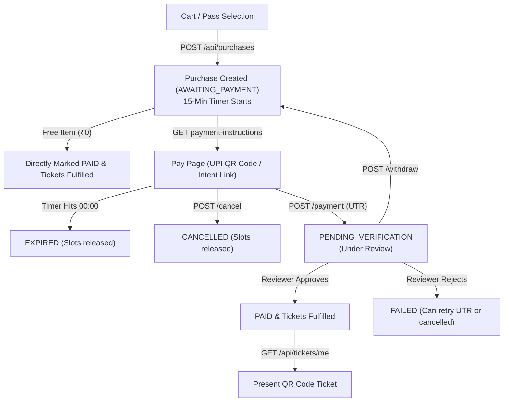

# Module 04: Purchases, Payments & Digital Tickets

This document covers the entire purchasing lifecycle: creating atomic reservations (with 15-minute expiration timer), fetching UPI payment instructions, submitting manual UPI UTR transaction IDs, withdrawing submissions, viewing event registrations, and presenting signed digital QR code tickets.

---

## 1. Purchase & Payment State Flows



---

## 2. Purchase Endpoints

### 2.1 Create Purchase Reservation
Creates a purchase reservation holding inventory slots for 15 minutes.
- **Student Tier Automatic Pricing**: If the buyer has student credentials on their profile (`is_student === true` and `institution_id` present), student pricing is automatically selected. In this case, `acknowledge_student_id_policy` **must** be set to `true`.
- **Free Purchases**: If the total price is ₹0 (0 paise), the purchase immediately transitions to `PAID` with `payment_method = 'FREE'`, and tickets/registrations are generated automatically.
- **Paid Purchases**: Returns `status: 'AWAITING_PAYMENT'` and `reservation_expires_at` (15 minutes from creation).
- **Idempotency**: Pass `Idempotency-Key: <UUID-v4>` header to protect against accidental duplicate charges on network retries.

- **Method**: `POST`
- **Path**: `/api/purchases`
- **Authentication**: Session Required + Profile Complete Required
- **Request Headers**:
  - `Content-Type: application/json`
  - `Cookie: __Host-session=<token>`
  - `Origin: <FRONTEND_ORIGIN>`
  - `Idempotency-Key: <UUID-v4>` (Recommended)

#### Request Body Schema
| Field | Type | Required | Description |
|---|---|---|---|
| `items` | `Array<PurchaseItemInput>` | **Yes** | 1 to 10 pass items to purchase |
| `items[].item_type` | `string` | **Yes** | `'GATE_PASS'` or `'EVENT_PASS'` |
| `items[].event_id` | `string` | Optional | Required when purchasing an individual solo `EVENT_PASS` |
| `items[].team_id` | `string` | Optional | Required when purchasing an `EVENT_PASS` for a team |
| `acknowledge_student_id_policy` | `boolean` | Optional | **Mandatory `true`** if any items qualify for student discount tier |

```json
{
  "items": [
    {
      "item_type": "GATE_PASS"
    }
  ],
  "acknowledge_student_id_policy": true
}
```

*Example for a Team Event Pass:*
```json
{
  "items": [
    {
      "item_type": "EVENT_PASS",
      "team_id": "tm_01j8m49p1k90ab"
    }
  ],
  "acknowledge_student_id_policy": true
}
```

#### Success Response
- **Status**: `201 Created`
```json
{
  "success": true,
  "data": {
    "id": "pur_01j8n12k5m30ab",
    "buyer_id": "usr_01j8k92b4m10ac",
    "total_amount_paise": 20000,
    "status": "AWAITING_PAYMENT",
    "payment_method": "UPI",
    "reservation_expires_at": 1729434600000,
    "fulfillment_status": "NOT_STARTED",
    "fulfillment_attempts": 0,
    "fulfillment_last_error": null,
    "idempotency_key": "9b1deb4d-3b7d-4bad-9bdd-2b0d7b3dcb6d",
    "idempotency_request_hash": "a1b2c3...",
    "student_policy_acknowledged_at": 1729433700000,
    "created_at": 1729433700000,
    "updated_at": 1729433700000,
    "items": [
      {
        "id": "pi_01j8n12k6a10cd",
        "purchase_id": "pur_01j8n12k5m30ab",
        "item_type": "GATE_PASS",
        "event_id": null,
        "team_id": null,
        "beneficiary_id": "usr_01j8k92b4m10ac",
        "tier": "STUDENT",
        "unit_price_paise": 20000,
        "registration_id": null,
        "holds_slot": 1,
        "created_at": 1729433700000
      }
    ],
    "registrations": []
  },
  "request_id": "req_01j7xyz..."
}
```

#### Possible Errors
| HTTP Status | Error Code | Description / Reason |
|---|---|---|
| `400` | `BAD_REQUEST` | Purchases disabled festival-wide, event is closed, or student policy not acknowledged for student discount tier. |
| `401` | `UNAUTHORIZED` | Session missing or expired. |
| `403` | `PROFILE_INCOMPLETE` | Buyer (or one of the team members) has not completed their profile. |
| `404` | `NOT_FOUND` | Event or team does not exist. |
| `409` | `CAPACITY_FULL` | Event or pass is sold out. |
| `409` | `CONFLICT` | Team has pending invites, invalid member count, or team is already locked/purchased. |
| `409` | `ALREADY_REGISTERED` | User is already registered for this event. |

---

### 2.2 List User's Purchases
Fetches all purchases made by the current user with complete item breakdowns and registrations.

- **Method**: `GET`
- **Path**: `/api/purchases`
- **Authentication**: Session Required

#### Success Response
- **Status**: `200 OK`
```json
{
  "success": true,
  "data": [
    {
      "id": "pur_01j8n12k5m30ab",
      "buyer_id": "usr_01j8k92b4m10ac",
      "total_amount_paise": 20000,
      "status": "PENDING_VERIFICATION",
      "payment_method": "UPI",
      "reservation_expires_at": 1729434600000,
      "fulfillment_status": "NOT_STARTED",
      "created_at": 1729433700000,
      "updated_at": 1729433800000,
      "items": [ ... ],
      "registrations": [ ... ]
    }
  ],
  "request_id": "req_01j7xyz..."
}
```

---

### 2.3 Get Purchase Details
Fetches detailed info for a single purchase.

- **Method**: `GET`
- **Path**: `/api/purchases/:id`
- **Authentication**: Session Required (Caller must be the buyer or Super Admin)
- **Path Parameters**:
  - `id`: Purchase UUID.

#### Success Response
- **Status**: `200 OK`
```json
{
  "success": true,
  "data": {
    "id": "pur_01j8n12k5m30ab",
    "buyer_id": "usr_01j8k92b4m10ac",
    "total_amount_paise": 20000,
    "status": "PAID",
    "payment_method": "UPI",
    "reservation_expires_at": 1729434600000,
    "fulfillment_status": "COMPLETED",
    "fulfillment_attempts": 1,
    "items": [ ... ],
    "registrations": [ ... ]
  },
  "request_id": "req_01j7xyz..."
}
```

#### Possible Errors
| HTTP Status | Error Code | Description / Reason |
|---|---|---|
| `404` | `NOT_FOUND` | Purchase does not exist or caller is not the buyer. |

---

### 2.4 Cancel Purchase Reservation
Releases the held slots and marks the purchase as `CANCELLED`. Can only be performed before payment is approved.

- **Method**: `POST`
- **Path**: `/api/purchases/:id/cancel`
- **Authentication**: Session Required (Caller must be buyer or Super Admin)
- **Path Parameters**:
  - `id`: Purchase UUID.

#### Success Response
- **Status**: `200 OK`
```json
{
  "success": true,
  "data": {
    "cancelled": true
  },
  "request_id": "req_01j7xyz..."
}
```

#### Possible Errors
| HTTP Status | Error Code | Description / Reason |
|---|---|---|
| `404` | `NOT_FOUND` | Purchase does not exist. |
| `409` | `CONFLICT` | Purchase is already `PAID` (cannot be cancelled by user). |

---

### 2.5 Retry Ticket Fulfillment
If a purchase is `PAID` but ticket generation encountered an edge failure (`fulfillment_status === 'FAILED'`), the buyer can trigger a safe retry.
- Rate limited to at most once per 5 seconds per purchase.

- **Method**: `POST`
- **Path**: `/api/purchases/:id/retry-fulfillment`
- **Authentication**: Session Required (Buyer or Super Admin)
- **Path Parameters**:
  - `id`: Purchase UUID.

#### Success Response
- **Status**: `200 OK`
```json
{
  "success": true,
  "data": {
    "fulfilled": true,
    "purchase_id": "pur_01j8n12k5m30ab",
    "tickets_created": 1
  },
  "request_id": "req_01j7xyz..."
}
```

#### Possible Errors
| HTTP Status | Error Code | Description / Reason |
|---|---|---|
| `400` | `BAD_REQUEST` | Purchase is not in `PAID` status. |
| `429` | `RATE_LIMITED` | Retry attempted too rapidly. Wait at least 5 seconds before retrying. |

---

## 3. UPI Payment Endpoints

### 3.1 Get Payment Instructions & UPI Deep Link
Fetches the UPI VPA address, formatted payable amount, generated UPI deep link URI, and active reservation timer.

- **Method**: `GET`
- **Path**: `/api/purchases/:id/payment-instructions`
- **Authentication**: Session Required (Buyer only)
- **Path Parameters**:
  - `id`: Purchase UUID.

#### Success Response
- **Status**: `200 OK`
```json
{
  "success": true,
  "data": {
    "purchase_id": "pur_01j8n12k5m30ab",
    "amount_paise": 20000,
    "amount_rupees": "200.00",
    "payee_vpa": "techxetra@upi",
    "payee_name": "TechXetra 2026",
    "upi_uri": "upi://pay?pa=techxetra%40upi&pn=TechXetra%202026&am=200.00&cu=INR&tn=TechXetra%20pur_01j8",
    "reservation_expires_at": 1729434600000
  },
  "request_id": "req_01j7xyz..."
}
```

> **Frontend Implementation Guide**:
> 1. Render `upi_uri` into an SVG/Canvas QR code using `qrcode.react`.
> 2. On mobile devices, provide an external link button: `<a href={upi_uri}>Pay with UPI App</a>`.
> 3. Compute `Math.max(0, reservation_expires_at - Date.now())` and run a `1-second interval` countdown timer.
> 4. When the countdown hits `00:00`, freeze the submission input and alert the user that the reservation has expired.

#### Possible Errors
| HTTP Status | Error Code | Description / Reason |
|---|---|---|
| `400` | `BAD_REQUEST` | Purchase is not awaiting payment or reservation has expired. |
| `404` | `NOT_FOUND` | Purchase does not exist or caller is not the buyer. |

---

### 3.2 Submit UPI Transaction ID (UTR)
Submits the 12-digit UPI reference / transaction ID (UTR) for human reviewer verification.
- Transitions the purchase status to `PENDING_VERIFICATION`.
- Supports the `Idempotency-Key` header.

- **Method**: `POST`
- **Path**: `/api/purchases/:id/payment`
- **Authentication**: Session Required + Profile Complete Required
- **Request Headers**:
  - `Content-Type: application/json`
  - `Cookie: __Host-session=<token>`
  - `Origin: <FRONTEND_ORIGIN>`
  - `Idempotency-Key: <UUID-v4>` (Recommended)

#### Request Body Schema
| Field | Type | Required | Validation Rules |
|---|---|---|---|
| `transaction_id` | `string` | **Yes** | 8 to 35 alphanumeric characters (usually 12-digit Indian banking UTR) |

```json
{
  "transaction_id": "429812345678"
}
```

#### Success Response
- **Status**: `201 Created`
```json
{
  "success": true,
  "data": {
    "id": "pay_01j8n25p8x40cd",
    "purchase_id": "pur_01j8n12k5m30ab",
    "expected_amount_paise": 20000,
    "transaction_id": "429812345678",
    "status": "PENDING",
    "reviewer_id": null,
    "reviewed_at": null,
    "rejection_reason": null,
    "internal_note": null,
    "resubmitted_from_payment_id": null,
    "created_at": 1729433800000,
    "updated_at": 1729433800000
  },
  "request_id": "req_01j7xyz..."
}
```

#### Possible Errors
| HTTP Status | Error Code | Description / Reason |
|---|---|---|
| `400` | `BAD_REQUEST` | Purchase reservation has expired or is not awaiting payment. |
| `400` | `INVALID_UTR` | Transaction ID is invalid (e.g. less than 8 chars). |
| `409` | `UTR_ALREADY_USED` | This transaction ID has already been submitted for another payment. |
| `409` | `PAYMENT_ALREADY_SUBMITTED` | This purchase already has an active pending payment submission. |

---

### 3.3 Withdraw Payment Submission
Allows a participant to withdraw a pending UTR submission (e.g. if they mistyped the number).
- Sets payment status to `WITHDRAWN`.
- Reverts the purchase status back to `AWAITING_PAYMENT`, allowing the participant to re-enter the correct UTR (provided the 15-minute window has not expired).

- **Method**: `POST`
- **Path**: `/api/payments/:id/withdraw`
- **Authentication**: Session Required (Buyer only)
- **Path Parameters**:
  - `id`: Payment UUID (`pay_...`).

#### Success Response
- **Status**: `200 OK`
```json
{
  "success": true,
  "data": {
    "id": "pay_01j8n25p8x40cd",
    "purchase_id": "pur_01j8n12k5m30ab",
    "expected_amount_paise": 20000,
    "transaction_id": "429812345678",
    "status": "WITHDRAWN",
    "created_at": 1729433800000,
    "updated_at": 1729434000000
  },
  "request_id": "req_01j7xyz..."
}
```

#### Possible Errors
| HTTP Status | Error Code | Description / Reason |
|---|---|---|
| `400` | `BAD_REQUEST` | Payment cannot be withdrawn because it is already `SUCCESS`, `FAILED`, or `WITHDRAWN`. |
| `404` | `NOT_FOUND` | Payment record does not exist or caller is not the owner. |

---

## 4. Registrations & Digital Tickets Endpoints

### 4.1 Get My Event Registrations
Fetches all confirmed and reserved event registrations for the logged-in user.
- Includes events registered as an individual attendee.
- Includes events registered as part of an accepted team roster.

- **Method**: `GET`
- **Path**: `/api/registrations`
- **Authentication**: Session Required

#### Success Response
- **Status**: `200 OK`
```json
{
  "success": true,
  "data": [
    {
      "id": "reg_01j8n30a4b10ef",
      "event_id": "evt_01j8k92b4m10ac",
      "team_id": "tm_01j8m49p1k90ab",
      "participant_id": "usr_01j8k92b4m10ac",
      "status": "CONFIRMED",
      "seat_count": 4,
      "created_at": 1729433900000,
      "updated_at": 1729434100000,
      "event_title": "Robo Wars: Heavyweight Arena",
      "event_category": "TECHNICAL",
      "day_of_event": 2,
      "event_venue": "Outdoor Arena 1",
      "team_name": "CyberKnights"
    }
  ],
  "request_id": "req_01j7xyz..."
}
```

---

### 4.2 Get My Digital Tickets
Fetches all digital tickets owned by the current participant, as well as any paid purchases whose tickets are currently being generated (`preparing_tickets`).

- **Method**: `GET`
- **Path**: `/api/tickets/me` (also available via `/api/me/tickets`)
- **Authentication**: Session Required

#### Success Response
- **Status**: `200 OK`
```json
{
  "success": true,
  "data": {
    "tickets": [
      {
        "id": "tkt_01j8n45c2m10ab",
        "purchase_item_id": "pi_01j8n12k6a10cd",
        "purchase_id": "pur_01j8n12k5m30ab",
        "ticket_type": "GATE_PASS",
        "tier": "STUDENT",
        "status": "ACTIVE",
        "validity": {
          "valid_from": 1793923200000,
          "valid_to": 1794182399000,
          "state": "VALID",
          "is_currently_valid": true
        },
        "qr_token": "tx1.tkt_01j8n45c2m10ab.1.aB39X_kd92P0kLQz2N...",
        "qr_version": 1,
        "event_checked_in_at": null,
        "purchase": {
          "id": "pur_01j8n12k5m30ab",
          "payment_status": "PAID",
          "total_amount_paise": 20000
        },
        "event": {
          "id": "gate-pass",
          "title": "TechXetra 2026 Fest Gate Pass (All 3 Days)",
          "category": "FEST_PASS",
          "venue": "Main Campus Gate",
          "day_of_event": 1,
          "starts_at": 1793923200000,
          "ends_at": 1794182399000
        },
        "student_id_warning": "Physical student institution ID card must be presented at entry for verification.",
        "created_at": 1729434100000,
        "updated_at": 1729434100000
      }
    ],
    "preparing_tickets": [
      {
        "purchase_id": "pur_01j8x...",
        "status": "PREPARING",
        "fulfillment_status": "IN_PROGRESS",
        "message": "Your tickets are currently being generated.",
        "can_retry": true,
        "retry_endpoint": "/api/purchases/pur_01j8x.../retry-fulfillment",
        "attempts": 0,
        "last_error": null
      }
    ]
  },
  "request_id": "req_01j7xyz..."
}
```

> **QR Token Format**:
> The `qr_token` string has the structure:
> `tx1.<ticket_id>.<qr_version>.<hmac_signature>`
> - Example: `tx1.tkt_01j8n45c2m10ab.1.aB39X_kd92P0kLQz2N`
> - Feed the exact string `ticket.qr_token` into your QR rendering component.

---

### 4.3 Get Single Ticket Details
Fetches full details for a single owned ticket.

- **Method**: `GET`
- **Path**: `/api/tickets/:id`
- **Authentication**: Session Required (Beneficiary / ticket owner only)
- **Path Parameters**:
  - `id`: Ticket UUID (`tkt_...`).

#### Success Response
- **Status**: `200 OK`
```json
{
  "success": true,
  "data": {
    "id": "tkt_01j8n45c2m10ab",
    "purchase_item_id": "pi_01j8n12k6a10cd",
    "purchase_id": "pur_01j8n12k5m30ab",
    "ticket_type": "EVENT_PASS",
    "tier": "GENERAL",
    "status": "ACTIVE",
    "validity": {
      "valid_from": 1794016800000,
      "valid_to": 1794031200000,
      "state": "VALID",
      "is_currently_valid": true
    },
    "qr_token": "tx1.tkt_01j8n45c2m10ab.1.zY90W_jd...",
    "qr_version": 1,
    "event_checked_in_at": null,
    "purchase": {
      "id": "pur_01j8n12k5m30ab",
      "payment_status": "PAID",
      "total_amount_paise": 50000
    },
    "event": {
      "id": "evt_01j8k92b4m10ac",
      "title": "Robo Wars: Heavyweight Arena",
      "category": "TECHNICAL",
      "venue": "Outdoor Arena 1",
      "day_of_event": 2,
      "starts_at": 1794016800000,
      "ends_at": 1794031200000
    },
    "student_id_warning": null,
    "created_at": 1729434100000,
    "updated_at": 1729434100000
  },
  "request_id": "req_01j7xyz..."
}
```

#### Possible Errors
| HTTP Status | Error Code | Description / Reason |
|---|---|---|
| `404` | `NOT_FOUND` | Ticket does not exist or caller is not the beneficiary. |
