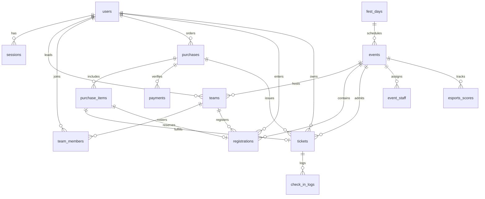

# 04 — Database Schema and Constraints

This document provides the complete Cloudflare D1 (SQLite) relational schema, partial unique indexes, check constraints, append-only triggers, and the atomic batch guard pattern.

---

## 🏛️ Entity-Relationship Diagram



---

## 📋 Table Definitions

### 1. Atomic Rollback Guard (`_guard`)
```sql
CREATE TABLE IF NOT EXISTS _guard (
  id INTEGER PRIMARY KEY CHECK (0)
);
```
- **Invariant**: Remains strictly empty. Any attempt to insert a row triggers `CHECK(0)` and causes Cloudflare D1 to abort and roll back the entire batch.

---

### 2. Users (`users`)
```sql
CREATE TABLE IF NOT EXISTS users (
  id TEXT PRIMARY KEY,
  google_sub TEXT UNIQUE,
  email TEXT NOT NULL UNIQUE,
  password_hash TEXT,
  name TEXT NOT NULL,
  avatar_url TEXT,
  phone TEXT,
  is_student INTEGER NOT NULL DEFAULT 0 CHECK (is_student IN (0, 1)),
  institution_name TEXT,
  institution_id TEXT,
  student_fields_locked INTEGER NOT NULL DEFAULT 0 CHECK (student_fields_locked IN (0, 1)),
  role TEXT NOT NULL DEFAULT 'PARTICIPANT' CHECK (role IN ('PARTICIPANT', 'VOLUNTEER', 'LEAD', 'SUPER_ADMIN')),
  can_review_payments INTEGER NOT NULL DEFAULT 0 CHECK (can_review_payments IN (0, 1)),
  is_active INTEGER NOT NULL DEFAULT 1 CHECK (is_active IN (0, 1)),
  profile_completed_at INTEGER,
  created_at INTEGER NOT NULL,
  updated_at INTEGER NOT NULL
);
CREATE INDEX IF NOT EXISTS idx_users_email ON users(email);
CREATE INDEX IF NOT EXISTS idx_users_role ON users(role);
```

---

### 3. Sessions (`sessions`)
```sql
CREATE TABLE IF NOT EXISTS sessions (
  id TEXT PRIMARY KEY, -- SHA-256 hash of raw session token
  user_id TEXT NOT NULL REFERENCES users(id) ON DELETE CASCADE,
  expires_at INTEGER NOT NULL,
  revoked_at INTEGER,
  ip_address TEXT,
  user_agent TEXT,
  created_at INTEGER NOT NULL,
  last_active_at INTEGER NOT NULL
);
CREATE INDEX IF NOT EXISTS idx_sessions_user_id ON sessions(user_id);
CREATE INDEX IF NOT EXISTS idx_sessions_expires_at ON sessions(expires_at);
```

---

### 4. Fest Days & Settings (`fest_days`, `settings`)
```sql
CREATE TABLE IF NOT EXISTS fest_days (
  day_number INTEGER PRIMARY KEY CHECK (day_number IN (1, 2, 3)),
  date TEXT NOT NULL UNIQUE,
  starts_at INTEGER NOT NULL,
  ends_at INTEGER NOT NULL,
  description TEXT,
  CONSTRAINT ck_fest_days_time CHECK (starts_at < ends_at)
);

CREATE TABLE IF NOT EXISTS settings (
  key TEXT PRIMARY KEY,
  value TEXT NOT NULL,
  updated_at INTEGER NOT NULL,
  updated_by TEXT REFERENCES users(id)
);
```

---

### 5. Events & Staff (`events`, `event_staff`, `gate_staff`)
```sql
CREATE TABLE IF NOT EXISTS events (
  id TEXT PRIMARY KEY,
  slug TEXT NOT NULL UNIQUE,
  title TEXT NOT NULL,
  category TEXT NOT NULL CHECK (category IN (
    'CULTURAL', 'TECHNICAL', 'E_SPORTS', 'SPORTS', 'MANAGEMENT',
    'LITERARY', 'WORKSHOP', 'INTERACTIVE', 'RECREATIONAL', 'SHOWCASE', 'OTHER'
  )),
  description TEXT,
  venue TEXT,
  day_of_event INTEGER NOT NULL REFERENCES fest_days(day_number),
  starts_at INTEGER NOT NULL,
  ends_at INTEGER NOT NULL,
  registration_closes_at INTEGER,
  status TEXT NOT NULL DEFAULT 'DRAFT' CHECK (status IN ('DRAFT', 'OPEN', 'CLOSED', 'COMPLETED', 'CANCELLED')),
  is_team_event INTEGER NOT NULL DEFAULT 0 CHECK (is_team_event IN (0, 1)),
  min_team_size INTEGER NOT NULL DEFAULT 1,
  max_team_size INTEGER NOT NULL DEFAULT 1,
  price_model TEXT NOT NULL DEFAULT 'FREE' CHECK (price_model IN ('FREE', 'PER_PARTICIPANT', 'PER_TEAM')),
  price_paise INTEGER NOT NULL DEFAULT 0 CHECK (price_paise >= 0),
  student_price_paise INTEGER CHECK (student_price_paise IS NULL OR student_price_paise >= 0),
  capacity INTEGER CHECK (capacity IS NULL OR capacity > 0),
  seats_taken INTEGER NOT NULL DEFAULT 0,
  capacity_unit TEXT NOT NULL DEFAULT 'SEATS' CHECK (capacity_unit IN ('SEATS', 'TEAMS')),
  scoring_enabled INTEGER NOT NULL DEFAULT 0 CHECK (scoring_enabled IN (0, 1)),
  scoring_status TEXT NOT NULL DEFAULT 'NOT_APPLICABLE' CHECK (scoring_status IN ('NOT_APPLICABLE', 'OPEN', 'FINALIZED')),
  max_rounds INTEGER NOT NULL DEFAULT 1 CHECK (max_rounds >= 1),
  volunteers_can_score INTEGER NOT NULL DEFAULT 0 CHECK (volunteers_can_score IN (0, 1)),
  leaderboard_public INTEGER NOT NULL DEFAULT 0 CHECK (leaderboard_public IN (0, 1)),
  metadata TEXT,
  form_schema TEXT,
  created_at INTEGER NOT NULL,
  updated_at INTEGER NOT NULL,
  CONSTRAINT ck_events_capacity CHECK (capacity IS NULL OR seats_taken <= capacity),
  CONSTRAINT ck_events_seats_positive CHECK (seats_taken >= 0),
  CONSTRAINT ck_events_team_size CHECK (min_team_size >= 1 AND max_team_size >= min_team_size),
  CONSTRAINT ck_events_esports_scoring CHECK (
    (category = 'E_SPORTS') OR
    (scoring_enabled = 0 AND leaderboard_public = 0 AND scoring_status = 'NOT_APPLICABLE')
  )
);
CREATE INDEX IF NOT EXISTS idx_events_status ON events(status);
CREATE INDEX IF NOT EXISTS idx_events_day ON events(day_of_event);
CREATE INDEX IF NOT EXISTS idx_events_category ON events(category);

CREATE TABLE IF NOT EXISTS event_staff (
  event_id TEXT NOT NULL REFERENCES events(id) ON DELETE CASCADE,
  user_id TEXT NOT NULL REFERENCES users(id) ON DELETE CASCADE,
  role TEXT NOT NULL CHECK (role IN ('LEAD', 'VOLUNTEER')),
  assigned_at INTEGER NOT NULL,
  assigned_by TEXT NOT NULL REFERENCES users(id),
  PRIMARY KEY (event_id, user_id)
);
CREATE INDEX IF NOT EXISTS idx_event_staff_user ON event_staff(user_id);
CREATE INDEX IF NOT EXISTS idx_event_staff_event_user ON event_staff(event_id, user_id);

CREATE TABLE IF NOT EXISTS gate_staff (
  user_id TEXT PRIMARY KEY REFERENCES users(id) ON DELETE CASCADE,
  assigned_at INTEGER NOT NULL,
  assigned_by TEXT NOT NULL REFERENCES users(id)
);
```

---

### 6. Teams & Members (`teams`, `team_members`)
```sql
CREATE TABLE IF NOT EXISTS teams (
  id TEXT PRIMARY KEY,
  event_id TEXT NOT NULL REFERENCES events(id),
  name TEXT NOT NULL,
  leader_id TEXT NOT NULL REFERENCES users(id),
  status TEXT NOT NULL DEFAULT 'DRAFT' CHECK (status IN ('DRAFT', 'LOCKED', 'CONFIRMED', 'CANCELLED')),
  created_at INTEGER NOT NULL,
  updated_at INTEGER NOT NULL
);
CREATE UNIQUE INDEX IF NOT EXISTS ux_teams_event_name_active ON teams(event_id, name) WHERE status != 'CANCELLED';
CREATE UNIQUE INDEX IF NOT EXISTS ux_teams_event_leader_active ON teams(event_id, leader_id) WHERE status != 'CANCELLED';

CREATE TABLE IF NOT EXISTS team_members (
  id TEXT PRIMARY KEY,
  team_id TEXT NOT NULL REFERENCES teams(id) ON DELETE CASCADE,
  user_id TEXT REFERENCES users(id),
  invited_email TEXT NOT NULL,
  role TEXT NOT NULL DEFAULT 'MEMBER' CHECK (role IN ('LEADER', 'MEMBER')),
  status TEXT NOT NULL DEFAULT 'INVITED' CHECK (status IN ('INVITED', 'ACCEPTED', 'DECLINED', 'REMOVED')),
  invited_at INTEGER NOT NULL,
  responded_at INTEGER
);
CREATE UNIQUE INDEX IF NOT EXISTS ux_team_members_team_email_active ON team_members(team_id, invited_email) WHERE status IN ('INVITED', 'ACCEPTED');
CREATE UNIQUE INDEX IF NOT EXISTS ux_team_members_team_user_active ON team_members(team_id, user_id) WHERE user_id IS NOT NULL AND status IN ('INVITED', 'ACCEPTED');
```

---

### 7. Purchases & Items (`purchases`, `purchase_items`)
```sql
CREATE TABLE IF NOT EXISTS purchases (
  id TEXT PRIMARY KEY,
  buyer_id TEXT NOT NULL REFERENCES users(id),
  total_amount_paise INTEGER NOT NULL CHECK (total_amount_paise >= 0),
  status TEXT NOT NULL DEFAULT 'AWAITING_PAYMENT' CHECK (status IN (
    'AWAITING_PAYMENT', 'PENDING_VERIFICATION', 'PAID', 'CANCELLED', 'EXPIRED'
  )),
  payment_method TEXT CHECK (payment_method IS NULL OR payment_method IN ('UPI', 'FREE')),
  reservation_expires_at INTEGER,
  fulfillment_status TEXT NOT NULL DEFAULT 'NOT_STARTED' CHECK (fulfillment_status IN (
    'NOT_STARTED', 'IN_PROGRESS', 'COMPLETED', 'FAILED'
  )),
  fulfillment_attempts INTEGER NOT NULL DEFAULT 0,
  fulfillment_last_error TEXT,
  idempotency_key TEXT,
  idempotency_request_hash TEXT,
  student_policy_acknowledged_at INTEGER,
  created_at INTEGER NOT NULL,
  updated_at INTEGER NOT NULL
);

CREATE TABLE IF NOT EXISTS purchase_items (
  id TEXT PRIMARY KEY,
  purchase_id TEXT NOT NULL REFERENCES purchases(id) ON DELETE CASCADE,
  item_type TEXT NOT NULL CHECK (item_type IN ('GATE_PASS', 'EVENT_PASS')),
  event_id TEXT REFERENCES events(id),
  team_id TEXT REFERENCES teams(id),
  beneficiary_id TEXT NOT NULL REFERENCES users(id),
  tier TEXT NOT NULL CHECK (tier IN ('GENERAL', 'STUDENT')),
  unit_price_paise INTEGER NOT NULL CHECK (unit_price_paise >= 0),
  registration_id TEXT REFERENCES registrations(id),
  holds_slot INTEGER NOT NULL DEFAULT 1 CHECK (holds_slot IN (0, 1)),
  created_at INTEGER NOT NULL
);
CREATE INDEX IF NOT EXISTS idx_purchase_items_event ON purchase_items(event_id, purchase_id);
```

---

### 8. Registrations & Payments (`registrations`, `payments`)
```sql
CREATE TABLE IF NOT EXISTS registrations (
  id TEXT PRIMARY KEY,
  event_id TEXT NOT NULL REFERENCES events(id),
  team_id TEXT REFERENCES teams(id),
  participant_id TEXT NOT NULL REFERENCES users(id),
  status TEXT NOT NULL DEFAULT 'RESERVED' CHECK (status IN ('RESERVED', 'CONFIRMED', 'CANCELLED', 'EXPIRED')),
  seat_count INTEGER NOT NULL DEFAULT 1 CHECK (seat_count >= 1),
  form_responses TEXT,
  created_at INTEGER NOT NULL,
  updated_at INTEGER NOT NULL
);
CREATE UNIQUE INDEX IF NOT EXISTS ux_registrations_event_participant ON registrations(event_id, participant_id) WHERE status IN ('RESERVED', 'CONFIRMED');

CREATE TABLE IF NOT EXISTS payments (
  id TEXT PRIMARY KEY,
  purchase_id TEXT NOT NULL REFERENCES purchases(id),
  expected_amount_paise INTEGER NOT NULL CHECK (expected_amount_paise >= 0),
  transaction_id TEXT NOT NULL,
  status TEXT NOT NULL DEFAULT 'PENDING' CHECK (status IN ('PENDING', 'SUCCESS', 'FAILED', 'ON_HOLD', 'WITHDRAWN')),
  reviewer_id TEXT REFERENCES users(id),
  reviewed_at INTEGER,
  rejection_reason TEXT,
  internal_note TEXT,
  resubmitted_from_payment_id TEXT REFERENCES payments(id),
  created_at INTEGER NOT NULL,
  updated_at INTEGER NOT NULL
);
CREATE UNIQUE INDEX IF NOT EXISTS ux_payments_active_purchase ON payments(purchase_id) WHERE status IN ('PENDING', 'ON_HOLD');
CREATE UNIQUE INDEX IF NOT EXISTS ux_payments_active_utr ON payments(transaction_id) WHERE status IN ('PENDING', 'ON_HOLD', 'SUCCESS');
```

---

### 9. Tickets & Check-in Logs (`tickets`, `check_in_logs`)
```sql
CREATE TABLE IF NOT EXISTS tickets (
  id TEXT PRIMARY KEY,
  purchase_item_id TEXT NOT NULL REFERENCES purchase_items(id),
  purchase_id TEXT NOT NULL REFERENCES purchases(id),
  ticket_type TEXT NOT NULL CHECK (ticket_type IN ('GATE_PASS', 'EVENT_PASS')),
  beneficiary_id TEXT NOT NULL REFERENCES users(id),
  event_id TEXT REFERENCES events(id),
  tier TEXT NOT NULL CHECK (tier IN ('GENERAL', 'STUDENT')),
  valid_from INTEGER NOT NULL,
  valid_to INTEGER NOT NULL,
  qr_version INTEGER NOT NULL DEFAULT 1 CHECK (qr_version >= 1),
  status TEXT NOT NULL DEFAULT 'ACTIVE' CHECK (status IN ('ACTIVE', 'REVOKED', 'REPLACED')),
  event_checked_in_at INTEGER,
  replaces_ticket_id TEXT REFERENCES tickets(id),
  created_at INTEGER NOT NULL,
  updated_at INTEGER NOT NULL,
  CONSTRAINT ck_tickets_validity CHECK (valid_from < valid_to)
);
CREATE UNIQUE INDEX IF NOT EXISTS ux_tickets_item_active ON tickets(purchase_item_id) WHERE status = 'ACTIVE';

CREATE TABLE IF NOT EXISTS check_in_logs (
  id TEXT PRIMARY KEY,
  ticket_id TEXT NOT NULL REFERENCES tickets(id),
  context TEXT NOT NULL CHECK (context IN ('GATE', 'EVENT')),
  event_id TEXT REFERENCES events(id),
  scanner_id TEXT NOT NULL REFERENCES users(id),
  verdict TEXT NOT NULL CHECK (verdict IN ('ADMITTED', 'DENIED', 'OVERRIDDEN')),
  reason TEXT,
  student_id_checked INTEGER NOT NULL DEFAULT 0 CHECK (student_id_checked IN (0, 1)),
  client_scan_id TEXT,
  created_at INTEGER NOT NULL
);
CREATE UNIQUE INDEX IF NOT EXISTS ux_checkin_event_once ON check_in_logs(ticket_id) WHERE context = 'EVENT' AND verdict = 'ADMITTED';
CREATE UNIQUE INDEX IF NOT EXISTS ux_checkin_client_scan_id ON check_in_logs(client_scan_id) WHERE client_scan_id IS NOT NULL;
```

---

### 10. E-Sports Scores & History (`esports_scores`, `esports_score_history`)
```sql
CREATE TABLE IF NOT EXISTS esports_scores (
  id TEXT PRIMARY KEY,
  event_id TEXT NOT NULL REFERENCES events(id),
  registration_id TEXT NOT NULL REFERENCES registrations(id),
  round_no INTEGER NOT NULL CHECK (round_no >= 1),
  score REAL NOT NULL CHECK (score >= -1000000 AND score <= 1000000),
  version INTEGER NOT NULL DEFAULT 1 CHECK (version >= 1),
  created_by TEXT NOT NULL REFERENCES users(id),
  updated_by TEXT NOT NULL REFERENCES users(id),
  created_at INTEGER NOT NULL,
  updated_at INTEGER NOT NULL,
  UNIQUE (event_id, registration_id, round_no)
);

CREATE TABLE IF NOT EXISTS esports_score_history (
  id TEXT PRIMARY KEY,
  score_id TEXT NOT NULL,
  event_id TEXT NOT NULL,
  registration_id TEXT NOT NULL,
  round_no INTEGER NOT NULL,
  old_score REAL,
  new_score REAL,
  version INTEGER NOT NULL,
  action TEXT NOT NULL CHECK (action IN ('CREATE', 'UPDATE', 'DELETE')),
  reason TEXT,
  actor_id TEXT NOT NULL REFERENCES users(id),
  created_at INTEGER NOT NULL
);

-- Append-only trigger for scores history
CREATE TRIGGER IF NOT EXISTS tr_esports_score_history_no_update
BEFORE UPDATE ON esports_score_history
BEGIN
  SELECT RAISE(ABORT, 'esports_score_history is append-only');
END;

CREATE TRIGGER IF NOT EXISTS tr_esports_score_history_no_delete
BEFORE DELETE ON esports_score_history
BEGIN
  SELECT RAISE(ABORT, 'esports_score_history is append-only');
END;
```

---

### 11. Immutable Audit Trails (`audit_logs`, `payment_audit_logs`)
```sql
CREATE TABLE IF NOT EXISTS audit_logs (
  id TEXT PRIMARY KEY,
  actor_id TEXT REFERENCES users(id),
  action TEXT NOT NULL,
  target_type TEXT NOT NULL,
  target_id TEXT NOT NULL,
  before_json TEXT,
  after_json TEXT,
  reason TEXT,
  ip_address TEXT,
  user_agent TEXT,
  created_at INTEGER NOT NULL
);

CREATE TRIGGER IF NOT EXISTS tr_audit_logs_no_update
BEFORE UPDATE ON audit_logs
BEGIN
  SELECT RAISE(ABORT, 'audit_logs is append-only');
END;

CREATE TRIGGER IF NOT EXISTS tr_audit_logs_no_delete
BEFORE DELETE ON audit_logs
BEGIN
  SELECT RAISE(ABORT, 'audit_logs is append-only');
END;

CREATE TABLE IF NOT EXISTS payment_audit_logs (
  id TEXT PRIMARY KEY,
  payment_id TEXT NOT NULL REFERENCES payments(id),
  purchase_id TEXT NOT NULL REFERENCES purchases(id),
  actor_id TEXT REFERENCES users(id),
  action TEXT NOT NULL,
  before_status TEXT,
  after_status TEXT,
  reason TEXT,
  internal_note TEXT,
  created_at INTEGER NOT NULL
);

CREATE TRIGGER IF NOT EXISTS tr_payment_audit_logs_no_update
BEFORE UPDATE ON payment_audit_logs
BEGIN
  SELECT RAISE(ABORT, 'payment_audit_logs is append-only');
END;

CREATE TRIGGER IF NOT EXISTS tr_payment_audit_logs_no_delete
BEFORE DELETE ON payment_audit_logs
BEGIN
  SELECT RAISE(ABORT, 'payment_audit_logs is append-only');
END;
```

---

## 🔒 Partial Unique Index Matrix

| Index Name | Table | Columns | Where Clause | Business Invariant Enforced |
|---|---|---|---|---|
| `ux_teams_event_name_active` | `teams` | `(event_id, name)` | `status != 'CANCELLED'` | Prevents duplicate team names for the same event unless earlier team cancelled. |
| `ux_teams_event_leader_active` | `teams` | `(event_id, leader_id)` | `status != 'CANCELLED'` | Prevents a user from creating multiple active teams for the same event. |
| `ux_team_members_team_email_active` | `team_members` | `(team_id, invited_email)` | `status IN ('INVITED', 'ACCEPTED')` | Prevents duplicate invitations to the same email in a team. |
| `ux_team_members_team_user_active` | `team_members` | `(team_id, user_id)` | `user_id IS NOT NULL AND status IN ('INVITED', 'ACCEPTED')` | Prevents a registered user from joining the same team multiple times. |
| `ux_registrations_event_participant` | `registrations` | `(event_id, participant_id)` | `status IN ('RESERVED', 'CONFIRMED')` | Prevents double-registration of a participant for an event. |
| `ux_payments_active_purchase` | `payments` | `(purchase_id)` | `status IN ('PENDING', 'ON_HOLD')` | Only one payment review may be pending for a purchase order at any time. |
| `ux_payments_active_utr` | `payments` | `(transaction_id)` | `status IN ('PENDING', 'ON_HOLD', 'SUCCESS')` | Prevents reusing the same 12-digit UTR across multiple purchases. |
| `ux_tickets_item_active` | `tickets` | `(purchase_item_id)` | `status = 'ACTIVE'` | Prevents generating duplicate active tickets for a single purchased item. |
| `ux_checkin_event_once` | `check_in_logs` | `(ticket_id)` | `context = 'EVENT' AND verdict = 'ADMITTED'` | Strictly enforces single-use admission for event tickets. |
| `ux_checkin_client_scan_id` | `check_in_logs` | `(client_scan_id)` | `client_scan_id IS NOT NULL` | Prevents duplicate scans caused by flaky scanner network re-transmissions. |
